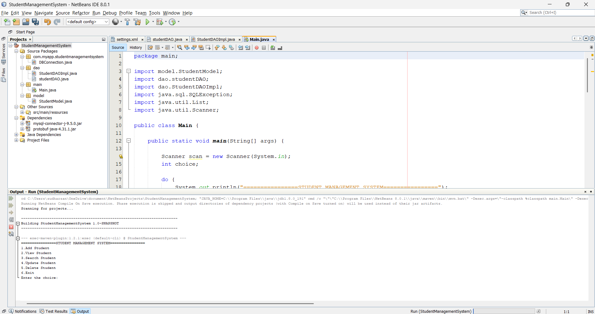
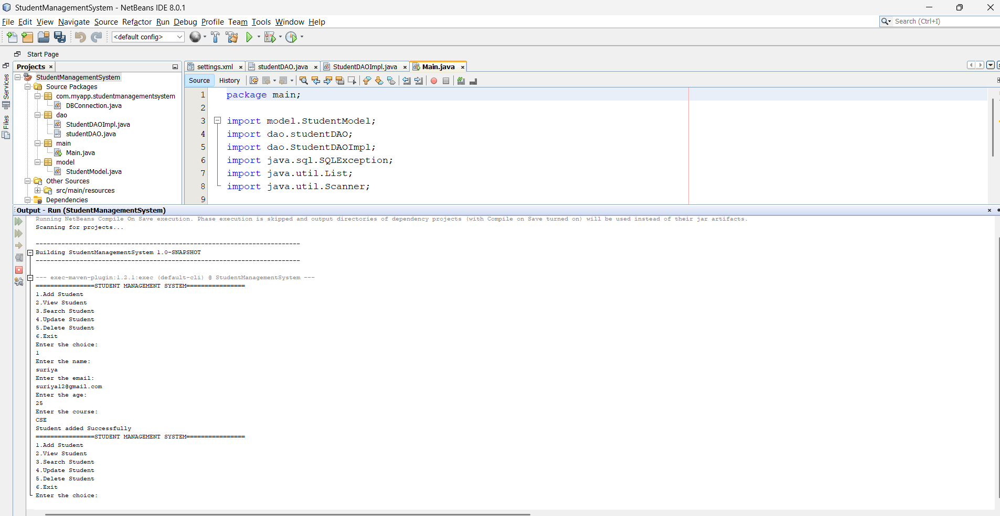
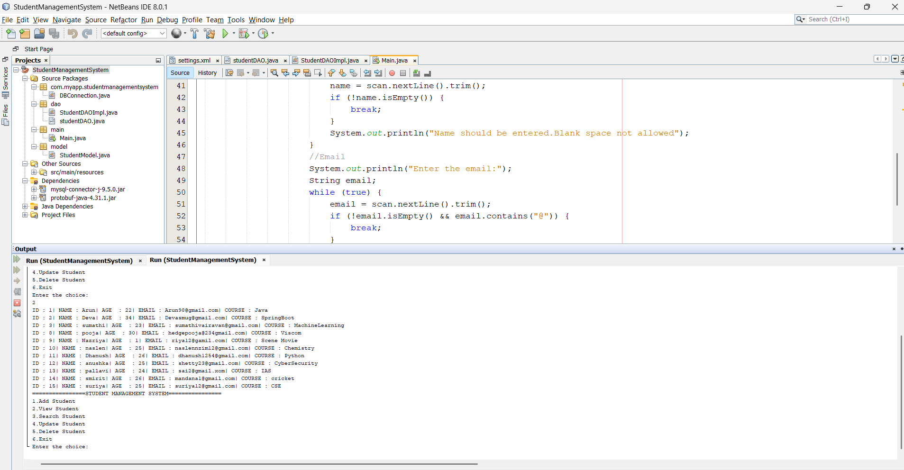
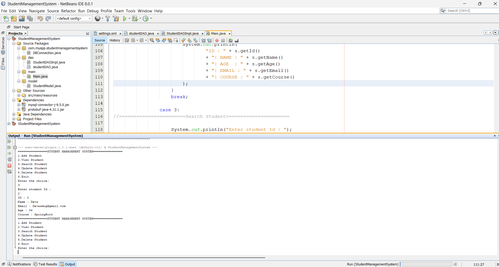
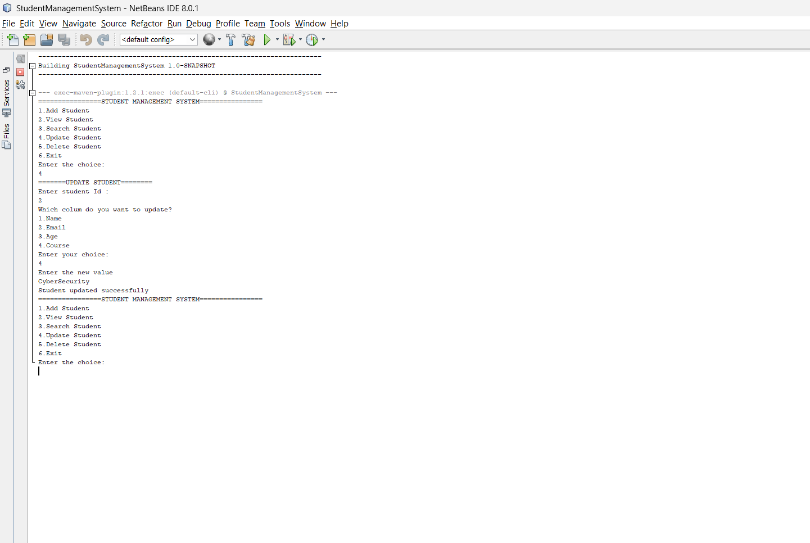
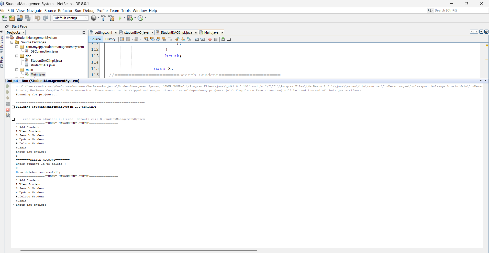

Student Management System

A Java console-based Student Management System developed using Java,JDBC and MySQL.

Features 
* Add Student
* View All Students
* Search Student
* Update Student
* Delete Student

Technologies Used

* Java
* JDBC
* MySQL
* Maven
* NetBeans

Project Purpose

This project demonstrations CRUD operations using Java and MySQL with JDBC database connectivity.

Developer

Java Developer| JAVA | JDBC | MySQL  

## Screenshots

### Main Menu

### Add Student

### View Student

### Search Student

### Update Student

### Delete Student

### Exit

